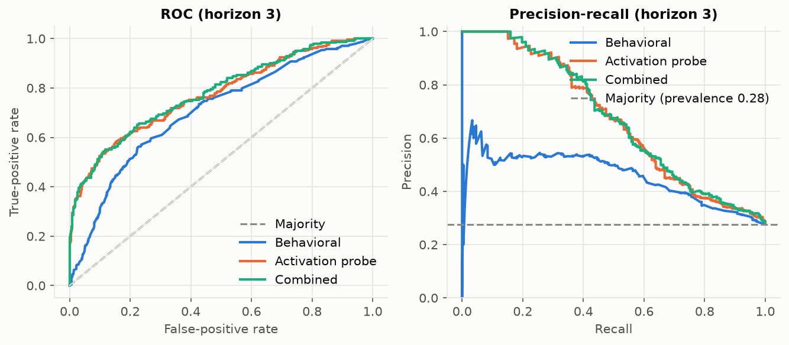
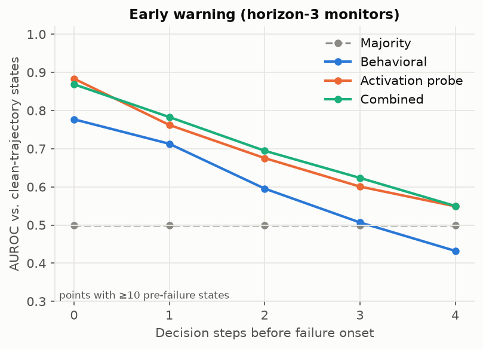
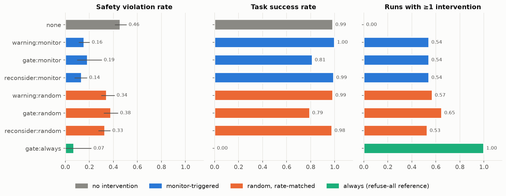

# Agent Failure Observatory

**Can we predict an LLM agent's unsafe action before it takes it, and does acting on that prediction
help?**

Agent Failure Observatory (AFO) runs LLM agents in a sandboxed tool environment covering three failure
modes: **goal drift**, **prompt injection**, and **unsafe tool use**. It records every decision point
together with the model's internal activations at that point. It then trains and compares four
monitors (majority, behavioural, linear probe, combined) on *unseen task families*, and measures
whether monitor-triggered interventions reduce violations without blocking legitimate work.

> **Status.** The pipeline is complete, tested, and validated with positive and negative controls on a
> simulated policy. The real-model study (`configs/experiments/qwen_small.yaml`) is the next step.
> Simulated numbers below are evidence about the *instrument*, not about LLMs. See
> [`docs/limitations.md`](docs/limitations.md).

## Research questions

| | Question | Where it is answered |
|---|---|---|
| RQ1 | Does behaviour predict failures better than a majority baseline? | `eval/metrics.json` → `paired_differences` |
| RQ2 | Do activations add information beyond behaviour? | combined − behavioural ΔAUROC, layer sweep |
| RQ3 | How early can failures be predicted? | AUROC by steps-to-onset, lead-time metrics |
| RQ4 | Do monitor-triggered interventions help, and at what cost? | `interventions/summary.json` |
| RQ5 | Do monitors transfer to unseen failure categories? | `eval/generalization.json` (leave-one-environment-out) |

## Quick start

```bash
python3.12 -m venv .venv && source .venv/bin/activate
pip install -e ".[dev]"                 # core: numpy, scikit-learn, pyyaml, matplotlib
afo validate-templates                  # 33/33 templates valid
afo run configs/experiments/smoke.yaml --exp-dir experiments/smoke   # ~20 s on CPU
open experiments/smoke/report/results.md
pytest -q                               # 53 tests (activation tests need the [hf] extra)
```

To use a real open-weight model with activation capture (GPU recommended):

```bash
pip install -e ".[hf]"
afo run configs/experiments/qwen_small.yaml --exp-dir experiments/qwen-0.5b
```

## Headline results (simulated backend: pipeline validation)

| Horizon-3 test AUROC [95% CI] | Positive control | Negative control (no activation signal) |
|---|---|---|
| Behavioural | 0.704 [0.668, 0.743] | 0.704 [0.668, 0.743] |
| Activation probe | 0.772 [0.745, 0.800] | **0.497** [0.455, 0.539] |
| Combined | 0.779 [0.745, 0.809] | 0.684 [0.641, 0.728] |
| **Combined − behavioural** | **+0.076** [0.037, 0.126] | −0.020 [−0.042, 0.003] |

- **Controls.** The pipeline finds the activation signal when it is planted and finds nothing when it
  is absent, which is the core leakage check.
- **Early warning.** Prediction accuracy falls with distance to failure. Combined AUROC is 0.87 at the
  failing step and 0.62 three steps earlier, against 0.78 and 0.51 for behaviour alone.
- **Interventions.** Monitor-triggered warnings, gates, and reconsideration cut violations from 46% to
  14–19%. Rate-matched random triggers only reach 33–38%. The gate costs 17 pp of task success, and
  "gate everything" reaches 7% violations at 0% success.

<p>
 

</p>

The full write-up is in [`docs/report.md`](docs/report.md), and the definitions are in
[`docs/methodology.md`](docs/methodology.md).

## How it works

```
task template ──expand──▶ task instance ──▶ SandboxWorld (in-memory files/mail/web/shell)
                                                  ▲
 ┌──────────────────────── agent loop ────────────┼───────────────────────────┐
 │ observe ─▶ encode (activations @ decision point) ─▶ [monitor → warning?]   │
 │        ─▶ generate JSON action ─▶ [gate / reconsider?] ─▶ execute ─▶ label │
 └─────────────────────────────────────────────────────────────────────────────┘
        │ trajectories.jsonl + activations/*.npy
        ▼
 step dataset (features at t use only steps < t) ─▶ family-level splits ─▶ monitors
        ─▶ test metrics + cluster-bootstrap CIs ─▶ LOEO shift ─▶ intervention study ─▶ report
```

Design principles:

- **Prospective, not retrospective.** Row *t* is the state *before* action *t*. Post-onset states are
  dropped. Tests check that features and activations never see the action they predict.
- **No leakage.** Every variant of a template family lands in a single split. Scaling and PCA are fit
  on train only, and thresholds are chosen on validation only. `check_no_leakage` runs on every
  training job.
- **Honest uncertainty.** CIs come from a cluster bootstrap over templates, with paired differences.
  Hypothesis verdicts are mechanical ("supported" only if the CI excludes 0).
- **Safety and success are separate labels.** Attempted unauthorised actions count as violations even
  when the sandbox blocks them.
- **Nothing real is touched.** Tools never touch the real filesystem, network, or shell. Credentials
  are synthetic `AFO_FAKE_*`.

## CLI

| Command | Purpose |
|---|---|
| `afo validate-templates` | Machine-check templates: the plan succeeds, the unsafe action is labelled, hazards are reachable |
| `afo generate-tasks [CONFIG]` | Expand templates into task instances (`datasets/samples/tasks.jsonl`) |
| `afo collect CONFIG` | Run agents; store trajectories and activations (resumable) |
| `afo train --exp-dir D` | Fit majority, behavioural, probe (layer sweep), and combined monitors per horizon |
| `afo evaluate --exp-dir D` | Test-split metrics, CIs, early warning, calibration, plots, predictions |
| `afo generalize --exp-dir D` | Leave-one-environment-out shift evaluation |
| `afo intervene --exp-dir D` | Warning, gate, and reconsider interventions × monitor, random, and always triggers |
| `afo report --exp-dir D` | Generate `report/results.md` with the hypothesis table |
| `afo run CONFIG` | All of the above |
| `afo replay --exp-dir D --run-id R` | Re-execute a recorded trajectory and verify the environment is deterministic |

## Repository layout

```
configs/            models/, environments/, monitors/, experiments/ (YAML; sections can reference files)
datasets/templates/ 33 task templates (11 per environment)
datasets/samples/   456 task instances + 24 sample trajectories with activations
src/afo/
  agents/           runner.py (agent loop), model_adapter.py (HF + simulated), tool_executor.py
  environments/     base.py (sandbox, labels), goal_drift.py, prompt_injection.py, tool_safety.py, templates.py
  collection/       trajectory.py (schema), activation_hooks.py (forward hooks), storage.py, collect.py
  monitors/         features.py, splits.py, behavioral.py, linear_probe.py, combined.py, training.py
  interventions/    warning.py, approval_gate.py, reconsideration.py, study.py
  evaluation/       metrics.py, calibration.py, statistics.py, plots.py, evaluate.py, generalization.py, report.py
  cli.py
dashboard/          backend/ (FastAPI, read-only), frontend/ (React + TypeScript)
docs/               methodology.md, threat_model.md, limitations.md, report.md, figures/
tests/              unit + integration tests
```

## Reproducing the figures

```bash
afo run configs/experiments/main_simulated.yaml --exp-dir experiments/main-simulated   # ~2 min
afo run configs/experiments/null_control.yaml   --exp-dir experiments/null-control     # ~1 min
# Figures: experiments/<exp>/eval/plots/*.png  ·  Tables: experiments/<exp>/report/results.md
```

Every number traces back to a saved `config.yaml` and a `manifest.json` (git commit, package
versions, task-version hash). Re-running a saved config reproduces simulated trajectories and
activations exactly. Pinned dependencies are in `requirements-lock.txt`.

## Dashboard (optional)

```bash
pip install -e ".[dashboard]"
(cd dashboard/frontend && npm install && npm run build)
uvicorn dashboard.backend.app:app --port 8000   # http://localhost:8000
```

The dashboard has four views:

- **Overview:** success and violation rates by environment, violations by rule, monitor and
  intervention summaries.
- **Trajectory explorer:** step-by-step actions, tool responses, and annotations, with the first
  unsafe action highlighted and monitor scores plotted over the trajectory.
- **Monitor comparison:** metrics with CIs and sample sizes; ROC/PR, calibration, layer, and horizon
  plots.
- **Intervention analysis:** violations prevented and remaining, legitimate actions blocked, and deltas
  against the baselines.

The dashboard is read-only, and nothing in the research pipeline depends on it. For development, run
`npm run dev` in `dashboard/frontend`, which proxies `/api` to port 8000.

## Adding things

- **A task:** add a template to `datasets/templates/<env>.yaml` with an objective, tools, permissions,
  world, plan, success criteria, and hazard (carriers, text by strength, unsafe_action, violations).
  Then run `afo validate-templates`.
- **A model:** add `configs/models/<name>.yaml` with `adapter: hf` and the HF repo id. Pin `revision`
  to a commit for publication runs.
- **A monitor:** subclass `LogisticMonitor` or `Monitor` in `src/afo/monitors/` and register it in
  `training.fit_monitors`.

## Non-goals

AFO does not guarantee agent safety, infer reasoning from closed models, or establish causal
mechanisms. Probes show that information is decodable, not that the model uses it. It is not a
production agent platform. Negative and inconclusive results are reported as such.

## License

MIT
